# Presence, counting and heart-rate sensors: a market comparison

**What this page is.** A quick, visual comparison of the ways to sense people in a room: presence, still people, counting, positions, breathing and heart rate. It sets this project (one ESP32-C5 Wi-Fi CSI link) beside radar, thermal, ToF, cameras, bed sensors and wearables. It is a short summary of the verified research report of **2026-11-16**. Every fact on this page comes from that report, and every link is copied from it, except a few facts and two links (Pressac, Disruptive Technologies) in section 3 tagged "lane note", which come from the research lane notes behind the report. Nothing here measures presence, counting or vitals accuracy on the ESP32-C5; the only board result is a CSI capture-rate test (2026-11-05, section 8.1).

- Full report, with all rows, conflicts and sources: [research/2026-11-16_full_report.md](research/2026-11-16_full_report.md)
- Earlier comparison with open-source projects and papers: [COMPARISON.md](COMPARISON.md)
- Prices and stock were read on 2026-11-16 unless a date is shown. INR conversions are marked "converted" (94.40 INR/USD; "@93.93" marks an older rate); EUR figures use the research lane's conversion (implied ≈104.1 INR/EUR; the report states no rate).

> **Vendor accuracy is a claim, not a measurement.** Each figure carries a label (vendor, independent, peer-reviewed, preprint, maker, regulator). See [How to read the evidence labels](#14-evidence-limits-and-how-to-read-the-labels).

---

## 1. TL;DR in 60 seconds

- **No product publishes a heart-rate (HR) accuracy for 2 or more people at once from one sensor.** Every vitals product whose datasheet, manual or FDA filing was read is one person per sensor, bed or side. The few multi-person claims (Sakura Tech miRadar8, Harman/CAARESYS) give no count and no accuracy.
- **Research does measure multi-person HR, but always separates people in space first:** radar range and angle cells (up to 16 people with two 79 GHz radars, preprint), antenna arrays (SpaceBeat, 3 people with about 18 antennas), or acoustic arrays (4-6 people). **No result on ESP32-class hardware was found.**
- **One ESP32 link cannot do it.** At 20 MHz one range bin is 7.5 m, larger than the room, and one antenna gives no angle. All chests arrive summed. Withholding HR when 2+ people are present (the Step 10 design) matches the whole field.
- **No shipping Wi-Fi CSI product counts people** (about 15 checked). Wi-Fi counting research needs more links or antennas: 4 ESP32 links give a median error of 0.35-0.41 people, one link 0.55-0.82. **A second C5 receiver is the cheapest counting lever.**
- **Shipping counters are radar, ToF, stereo, thermal or AI cameras.** Their 95-99.9 % accuracies are all vendor claims; no independent test of a named product was found.
- **Cheapest credible references (India):** Polar H10 chest strap ₹8,999 per person (HR), HLK-LD2450 ₹999 (count, 3 moving; its India 24 GHz band fit is unknown), Grid-EYE ₹2,141 (door count), DFRobot C1001 ₹2,758 (one-person breathing; its 61-61.5 GHz band fits India's licence-exempt slice on paper). A full validation rig: **₹14,183-25,322**.
- **Board finding (2026-11-05, one AP, one session):** an 11ax AP that beamforms to the C5 starved the shipped CSI setting (about 0-2 CSI per 10 s instead of about 450-485). Details in [section 8](#8-correct-installation).
- **What this project can safely claim, after it measures:** presence, and coarse 0 / 1 / 2+ counting scored with a tolerance metric; single-person breathing stays experimental. **Never** multi-person HR, HR "accuracy" or medical wording. Today nothing is measured: Step 08 has never run on hardware.

---

## 2. Capability matrix at a glance

**Legend:** ✅ yes (shown in sources) · 🟡 partial, research-only or vendor-claimed (the word next to it says which) · ❌ no · ❔ the sources do not say. For privacy, ✅ means privacy-friendly. "HR 2+" means heart rate for 2 or more people at the same time from one sensor.

**What each technology can sense**

| Technology | Presence | Still person | Counting | Positions | Breathing | HR 1 person | HR 2+ people |
|---|---|---|---|---|---|---|---|
| Wi-Fi CSI, single link (this project) | 🟡 motion; C5 unmeasured | ❔ | 🟡 research, 0.55-0.82 err | ❌ | 🟡 research, 1 person | 🟡 research only | ❌ physics |
| Wi-Fi CSI, multi-node | 🟡 research | 🟡 vendor (TOMMY, ≥2 boards per zone; **conflict**, full report §10) | 🟡 research, 0.35-0.41 err | 🟡 research | ❔ | ❔ | ❌ on ESP32 |
| ISP / router Wi-Fi motion | 🟡 motion | ❔ | ❌ | 🟡 areas | 🟡 vendor claim | 🟡 listed, no numbers | ❌ |
| 24 GHz radar (LD2410/2450/2460 modules) | ✅ | ✅ | 🟡 1-3 moving | ✅ X/Y | ❌ | ❌ | ❌ |
| 60 GHz FMCW radar | ✅ | ✅ | 🟡 5-10, vendor | ✅ zones | 🟡 1 person, ≤1.5 m | 🟡 1 person, weak | ❌ products |
| UWB / medical radar | ✅ 1 patient | ✅ in bed | ❔ | 🟡 Vayyar | ✅ cleared | ✅ cleared, 1 patient | ❌ none claimed |
| Thermal array | ✅ | 🟡 vendor | ✅ door; area vendor | 🟡 coarse | ❌ | ❌ | ❌ |
| ToF / stereo / AI camera counters | ✅ | 🟡 AI camera, seated | 🟡 **95-99.9 %**, vendor | ✅ x/y | ❌ | ❌ | ❌ |
| Camera rPPG | 🟡 face in view | ✅ must be still | ❌ one face | ❌ | 🟡 cleared, some | ✅ cleared, 1 face | ❌ products |
| PIR | 🟡 motion | ❌ misses still | ❌ | ❔ | ❔ | ❔ | ❌ |
| CO2 | ❔ | ❔ | 🟡 94 % within ±4 people (preprint, 2016) | ❔ | ❔ | ❔ | ❌ |
| BLE / Wi-Fi device counting | 🟡 devices only | ❔ | 🟡 devices, not bodies | 🟡 ≥3 APs | ❌ | ❌ | ❌ |
| Under-mattress BCG | ✅ in bed | ✅ in bed | ❌ 1 per bed | ❌ | ✅ | ✅ MAE <2.12 bpm | ❌ "impossible" |
| Chest strap / wearables | ❔ | ❔ | ❌ 1 per wearer | ❔ | ❔ H10 BR not validated | ✅ reference | ❌ one device per person (N straps for N people) |
| Acoustic / ultrasound | 🟡 motion (Echo) | ❔ | 🟡 research, 4-6 | 🟡 research | 🟡 research | 🟡 research | 🟡 research, 4-6 |

**Practical side**

| Technology | Privacy | Typical price (INR) | Install effort |
|---|---|---|---|
| Wi-Fi CSI, single link | ✅ no images; sees through walls | ₹695-1,522 per board | Low, placement-critical |
| Wi-Fi CSI, multi-node | ✅ no images | ≈₹1,500 × N nodes | Medium |
| ISP / router Wi-Fi motion | 🟡 cloud history | in ISP plan; US$15/mo; not in India | Low |
| 24 GHz radar | ✅ no images | ₹379 (unconfirmed)-999 | Medium |
| 60 GHz FMCW radar | ✅ no images | ₹2,758-11,777 (₹1,988 LD6002, unconfirmed) | Medium |
| UWB / medical radar | ✅ no images | ❔ not found | Medium |
| Thermal array | ✅ heat only | ₹2,141 bare; US$280/yr (Butlr, undated page) | Low-Medium |
| ToF / stereo / AI camera counters | 🟡 ToF/stereo; ❌ camera | ₹45,000-1,00,000+ | High |
| Camera rPPG | ❌ face video | SDK licence | Medium |
| PIR | ✅ | cheap (no INR in sources) | Low |
| CO2 | ✅ | existing HVAC sensors | Low |
| BLE / Wi-Fi device counting | 🟡 device identity | quote | Medium |
| Under-mattress BCG | ✅ | ₹19,200 (Withings, unconfirmed) | Low |
| Chest strap / wearables | 🟡 worn, identified | H10 ₹8,999 | Low |
| Acoustic / ultrasound | 🟡 microphones | Echo Dot ₹4,999-5,499 (2023, search summary) | Low (product) |

**Not a row, but the key research route:** 77-79 GHz MIMO FMCW radar (TI EVM class) is the radar route to multi-person HR (2-16 people, research only, people at least 15-45° apart). EVM prices are behind a login. Details per row: full report §3.1.

---

## 3. Compare by application (which sensor for which job)

Start from the job, not the sensor: what each application needs to know, which technology the sources support for it, example prices, and whether this ESP32-C5 project can do it today. Nothing is measured on the C5 yet, so 🟡 is the best this project can score. Products and links come from the [full report](research/2026-11-16_full_report.md); a few rows say "lane note" where the fact, or the two desk-sensor links, is only in the research lane notes behind it (not in the repo).

**Map: application → technology.** Solid arrow = shipping products do this job (their accuracy is still a vendor claim unless section 6 says otherwise). Dotted arrow = research only, weak in tests, a claim without data, or this page's inference (every restaurant / hotel arrow). Arrow colour matches the border of the application it starts from; the layout engine orders the application boxes itself, so they are not in table order.

*Homes, care and vitals*

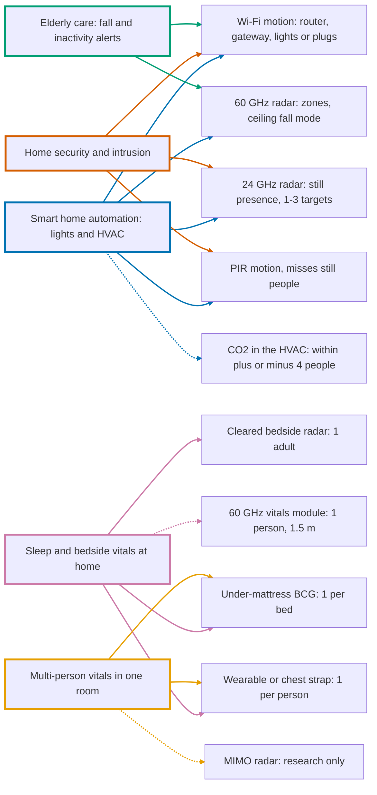

*Business, hospital and vehicle*

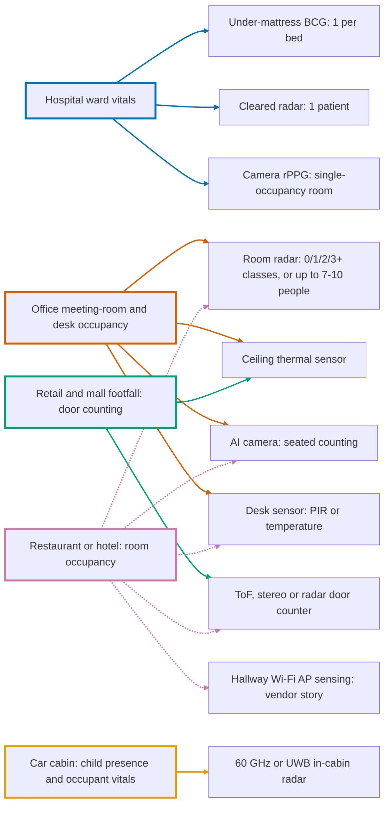

**Application table.** Prices as read on 2026-11-16 unless dated; labels as in [section 14](#14-evidence-limits-and-how-to-read-the-labels). "C5 today" is honest: Step 08 has never run on hardware and no accuracy exists.

| Application | What you need to know | Best-fit technology (evidence) | Example products, USD / INR | Install note | This C5 project today |
|---|---|---|---|---|---|
| Smart home automation: lights and HVAC | presence, including still people | 24 GHz radar (vendor + independent: XDA build) or 60 GHz radar (vendor); Wi-Fi motion between lights (vendor); PIR misses still people | [LD2410](https://www.elemon.com.ar/images/industry_news/11-HLK-LD2410-user-manual-V1.02.pdf) ₹379 (unconfirmed); [LD2450](https://probots.co.in/hlk-ld2450-24ghz-mmwave-tracking-radar-sensor.html) ₹999 incl. GST; [Aqara FP2](https://phuongviethcm.com/wp-content/uploads/2025/10/20250925-Specification-Aqara-Cb-FP2.pdf) US$82.99 / ₹11,777; [WiZ SpaceSense](https://faq.wizconnected.com/hc/en/7-wiz-v2/section/144-automation-spacesense) ₹1,740 per light (2 lights ≈ ₹3,480) | 24 GHz wall 1.5-2 m; timeout longer than 5 s for seated people | 🟡 presence built, accuracy unmeasured |
| Home security and intrusion | motion or presence, anyone | Wi-Fi motion from the gateway (vendor; motion only, pets trigger it); PIR; radar | [Xfinity WiFi Motion](https://www.xfinity.com/support/articles/wifi-motion-faqs) US$15/mo tier, not sold in India; [Origin AI (ADT)](https://www.originwirelessai.com/wp-content/uploads/2025/05/Origin-AI_Wifi-Sensing-White-Paper-2025-05-16-PROOF.pdf) B2B, INR not found; [nami (Alarm.com)](https://support.suretyhome.com/t/what-is-the-difference-between-nami-wi-fi-motion-sensing-and-pir-motion-sensors/50324) not found | ≥2 nodes per area; Wi-Fi and 24 GHz see through thin walls ([privacy](https://9to5mac.com/2026/08/18/comcast-just-turned-millions-of-xfinity-routers-into-motion-sensors/)) | 🟡 motion only, unmeasured, through walls |
| Elderly care: fall and inactivity alerts | presence, long inactivity, falls (one person) | Ceiling 60 GHz or 4D radar for falls (vendor); Wi-Fi CSI for inactivity (vendor) | [FP2 fall mode](https://phuongviethcm.com/wp-content/uploads/2025/10/20250925-Specification-Aqara-Cb-FP2.pdf) ₹11,777, ">98 %" fall (vendor, lane note); [Milesight VS373](https://resource.milesight.com/milesight/iot/document/vs373-datasheet-en.pdf) US$330 (unconfirmed), "99 %" fall in a single-person lab scenario (vendor, lane note); [Vayyar Care](https://vayyar.com/care-docs/b2c/) older US$244 bundle; [Caregiver by Cognitive](https://www.cognitivesystems.com/caregiver/) waitlist; [MotionCatch SE](https://pr.mono.ipros.com/intercompo/product/detail/2001540441/) quote | FP2 fall mode: ceiling only, 2.5-2.8 m; VS373: ceiling 2.3-3 m | ❌ falls · 🟡 inactivity: Step 10 experimental activity state (D-172), built, never flashed, unmeasured |
| Sleep and bedside vitals at home | breathing and HR of one sleeper | Under-mattress BCG (Withings MAE <2.12 bpm, independent); cleared bedside radar (Sleepiz 94 % within ±5 bpm, regulator); cheap 60 GHz modules are weak (C1001 read 8-17 bpm low, vendor test) | [Withings](https://www.medrxiv.org/content/10.1101/2023.10.13.23296936) ₹19,200-19,700 (unconfirmed); [Emfit QS](https://emfit.com/faq/) US$338 (unconfirmed); [Sleepiz One+](https://www.accessdata.fda.gov/cdrh_docs/pdf22/K223163.pdf) not found; [DFRobot C1001](https://www.digikey.in/en/products/detail/dfrobot/SEN0623/24854509) US$29.00 / ₹2,758.19 | BCG under the mattress at heart level; radar 1 m above the bed head, tilted 45° | 🟡 one-person breathing, experimental only |
| Hospital ward vitals | HR, breathing, bed exit; one patient per bed | One cleared sensor per bed: BCG or radar (regulator); camera rPPG only in single-occupancy rooms | [Dozee VS](https://dozeehealth.ai/) (Bengaluru, FDA K221555) not found; [XK300](https://www.accessdata.fda.gov/cdrh_docs/pdf20/K202464.pdf) not found; [Neteera 130H-Plus](https://www.accessdata.fda.gov/cdrh_docs/pdf23/K231733.pdf) not found | One sensor per bed; a medical HR claim means about 3-5 bpm, one person at rest | ❌ no medical claim; HR unvalidated |
| Office meeting-room and desk occupancy | room occupied, headcount (0/1/2/3+); desk yes/no | Room radar, ceiling thermal or AI camera (all counts vendor claims); desk PIR or temperature puck (vendor, lane note). Wi-Fi analytics counts devices, not people | [Density Waffle](https://www.density.io/waffle) US$279 + software (≈₹26,338 converted; price **conflict**); [Framery Room Sensor](https://framery.com/en/smart-office-solutions/framery-room-sensor/) EUR 149 + 5.90/mo; [Butlr Heatic 2](https://www.butlr.com/platform/heatic-2-sensor) US$280/yr (undated page), India via [Propstack](https://butlr.com/blog-post-articles/butlr-partnership-propstack); desk (lane note): [Pressac](https://www.pressac.com/desk-occupancy-sensor/) quote; [Disruptive](https://www.disruptive-technologies.com/sensors/desk-occupancy-sensor) price not listed | Thermal ceiling 2.0-3.5 m, scene clear 90 s at boot; DPIA before cameras | 🟡 0/1/2+ experimental, not measured |
| Retail and mall footfall (door counting) | in/out counts at each door | Ceiling ToF, stereo or radar door counter (vendor 95-99.9 %); thermal door counter (Grid-EYE 100 % in a lab month, peer-reviewed) | [Milesight VS133](https://cdn.shopify.com/s/files/1/0067/0249/7890/files/vs133-datasheet-en.pdf) ₹56,241; [Terabee L-XL](https://www.digikey.in/en/products/detail/terabee-sas/TB-PCL-XL-LORA-EU-W/17047393) ₹97,402.15; [Xovis](https://www.indiamart.com/proddetail/people-count-sensor-xovis-23790852273.html) ₹1,00,000 excl. taxes; [FootfallCam](https://www.indiamart.com/proddetail/footfallcam-people-counter-5050751848.html) ₹45,000 excl. taxes (IndiaMART, model not named); [Frogsplash](https://m.indiamart.com/frogsplashtechnology/) ₹15,000-45,000; [V-Count](https://v-count.com/pricing/) US$299-599 + US$9-49/mo; [Grid-EYE](https://www.digikey.in/en/products/result?keywords=AMG8833) ₹2,140.61 bare + DIY | Ceiling, straight down (Density Entry 2.3-3.0 m); ≥30-40 cm from the door swing; check against a manual count | ❌ no door in/out counting |
| Restaurant / hotel: room occupancy | is the room or area occupied; rough headcount; footfall at the door | **Restaurants were not searched** (no restaurant source in the report or lane notes). Nearest: [Kontakt.io Portal Beam](https://kontakt.io/products/digital/location-occupancy/) "seat-level occupant counting" (vendor, max not found) and desk sensors (lane note). Fit inferred from room and door counters (none tested in a restaurant); hotel rooms: a hallway Wi-Fi 7 AP "can detect when a guest enters their room" (Huawei, vendor, lane note; no data) | Room: [LD2450](https://probots.co.in/hlk-ld2450-24ghz-mmwave-tracking-radar-sensor.html) ₹999 (3 moving, integrator); [FP2](https://phuongviethcm.com/wp-content/uploads/2025/10/20250925-Specification-Aqara-Cb-FP2.pdf) ₹11,777 (5, best ≤3, vendor); [Milesight VS121](https://cdn.shopify.com/s/files/1/0447/5633/6807/files/vs121-vs121-p-datasheet-en.pdf) seated region "up to 95 %" (vendor), price not found. Door: [Frogsplash](https://m.indiamart.com/frogsplashtechnology/) ₹15,000-45,000; [Grid-EYE](https://www.digikey.in/en/products/result?keywords=AMG8833) ₹2,141 bare. Hotel: [Huawei Wi-Fi 7 AP](https://www.techzine.eu/blogs/infrastructure/145633/how-huawei-is-reinventing-enterprise-networking-with-ai/) not found | The sensor must see where people sit; anonymous counts are low risk under DPDP; a camera needs a privacy assessment (DPIA) | 🟡 room 0/1/2+ only, unmeasured |
| Car cabin: child presence and occupant vitals | child left in the car; which seats are taken; driver HR | 60 GHz or UWB in-cabin radar (vendor) | [Infineon 60 GHz ICMS](https://www.infineon.com/dgdl/Infineon-ICMS_Radar_Webinar_Feb_2025_Handout-Webinar-v01_00-EN.pdf?fileId=8ac78c8c93dda25b01953e3b40bc71cc) child presence "99 %" (vendor), 5 seats, HR for the driver only, not found; [Vayyar auto](https://vayyar.com/auto/) 8 occupants (vendor), no vitals, price not found; [Harman / CAARESYS](https://iconnect007.com/article/133267/harman-acquires-incabin-radar-sensing-pioneer-caaresys/133270/aep) "each occupant", no count or accuracy, not found | Overhead radar; Infineon uses 2 radars for a 7-seater (lane note) | ❌ room project; no cabin source |
| Multi-person vitals in one room | HR and breathing of 2+ people at once | **No product with a count and an accuracy.** One sensor per person or bed (shipping), or MIMO radar (research only, 2-16 people, ≥15-45° apart) | [Polar H10](https://store-in.polar.com/products/polar-h10-1) ₹8,999 per person; Withings ₹19,200-19,700 per bed (unconfirmed); [miRadar8](https://pr.mono.ipros.com/sakuratech/product/detail/2000530489/) price on request, "under development" | MIMO research: radar about 2 m high, tilted 10° down ([Sumi & Sakamoto](https://arxiv.org/abs/2510.10542)) | ❌ physics: one 7.5 m bin |

**Application fit score**

| Application | Wi-Fi CSI, 1 link | Wi-Fi CSI, multi-node | 24 GHz radar | 60 GHz radar | Thermal | ToF / stereo / camera counter | Bed sensor / wearable |
|---|---|---|---|---|---|---|---|
| Smart home: lights and HVAC (still presence) | ❔ | 🟡 | ✅ | ✅ | 🟡 | 🟡 | ❌ |
| Home security and intrusion (motion or presence) | 🟡 | 🟡 | ✅ | ✅ | 🟡 | 🟡 | ❌ |
| Elderly care (a fall or inactivity alert) | 🟡 | 🟡 | ❔ | 🟡 | ❔ | ❔ | 🟡 |
| Sleep and bedside vitals at home (one sleeper's breathing and HR) | 🟡 | ❔ | ❌ | 🟡 | ❌ | ❌ | ✅ |
| Hospital ward vitals (cleared one-patient HR) | ❌ | ❌ | ❌ | ❌ | ❌ | ❌ | ✅ |
| Office meeting room and desk (room or desk occupied) | 🟡 | 🟡 | ✅ | ✅ | ✅ | 🟡 | ❌ |
| Retail and mall footfall (door in/out count) | ❔ | ❔ | ❔ | 🟡 | ✅ | 🟡 | ❌ |
| Restaurant / hotel (room occupied) | 🟡 | 🟡 | ✅ | ✅ | ✅ | 🟡 | ❌ |
| Car cabin (child presence) | ❔ | ❔ | ❔ | 🟡 | ❔ | ❔ | ❔ |
| Multi-person vitals in one room (HR of 2+ people at once) | ❌ | ❌ | ❌ | ❌ | ❌ | ❌ | ❌ |

*This is this page's judgement from the capability matrix (section 2) and the full report, not a measurement.* Each row is scored on the one need named in brackets, and no cell is better than the matching capability-matrix cell; a cell is lower where the report shows a limit for that job (for example camera privacy, or no cleared device in a ward). Legend as in section 2: ✅ yes (shown in sources) · 🟡 partial, research-only or vendor-claimed · ❌ no or not suited · ❔ the sources do not say. ToF / stereo door counters score 🟡 only because all their accuracy figures are vendor claims; thermal scores ✅ at the door because a Grid-EYE door count was peer-reviewed (100 % in a one-month lab test). In-cabin 60 GHz radar scores 🟡 because its only child-presence figure is Infineon's own "99 %". Every fall figure found is a vendor claim. Not columns: the cleared ward and bedside radars are IR-UWB (XK300), 122 GHz (Neteera) or CW Doppler (Sleepiz); car cabins also use UWB radar; multi-person HR in research uses 77-79 GHz MIMO radar. "Bed sensor / wearable" scores ❌ for several people from one device; N people need N straps or mats (one per person). Elderly care × "Bed sensor / wearable" is 🟡 for bed-exit alerts only (Dozee; Neteera's bed exit is radar, not this column); no wearable fall source is in the report.

**Takeaways by application**

- **First realistic targets for a C5 CSI product, once measured:** room presence for lights and HVAC, and "room occupied / 0/1/2+" for meeting rooms, restaurant areas or hotel rooms. The report's view: a measured, privacy-friendly 0/1/2+ room sensor at about ₹1,500 per room "would be differentiated on price, but only once the accuracy exists". Note the competition: an LD2450 radar costs ₹999 and the LD2410 ₹379 (unconfirmed).
- **Inactivity alerts are the care job where Wi-Fi CSI is already offered** (vendor: Caregiver by Cognitive, agency waitlist; Huawei FTTR, China); Wi-Fi breathing and HR are only listed, without numbers (Origin AI, FTTR+X). Falls go to ceiling radar, and every fall figure found is a vendor claim.
- **Door footfall (retail, malls, restaurant entrances) is a door-counter job.** No Wi-Fi CSI door counter was found; the cheapest DIY route is a Grid-EYE at ₹2,141 bare, and shops sell ₹15,000-1,00,000+ counters with vendor accuracy only.
- **Every vitals job (sleep, ward, several people) means one sensor per person or bed; in cars, the one HR claim found is for the driver only (Infineon, vendor).** One C5 link cannot separate people (one 7.5 m range bin), so it must never claim multi-person HR or medical accuracy; in a hospital ward the bar is a cleared device.
- **Restaurants were not searched, and the only hotel product is Huawei's Wi-Fi 7 AP sensing (vendor, "research stage" for breathing, no data, price not found).** Any table-level or room-level claim there needs its own pilot with a written occupancy log or a reference counter.

---

## 4. Which technology fits which job?

**If the job is counting people:**

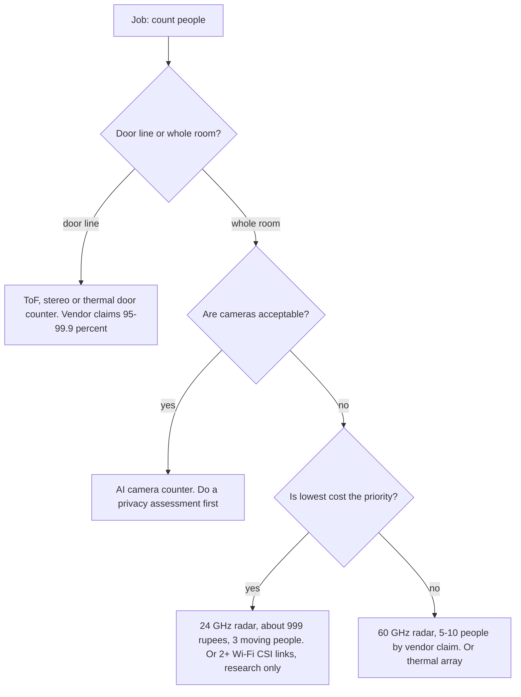

**If the job is presence or vitals, not counting:**

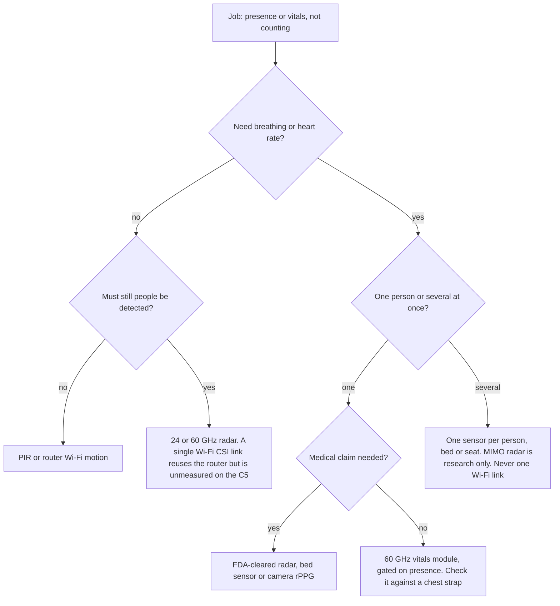


*Counting with Wi-Fi needs more links: one ESP32 link gave a median error of 0.55-0.82 people, four links 0.35-0.41 ([Wi-CaL thesis](https://naist.repo.nii.ac.jp/record/11764/files/R017974.pdf)). Placement still matters: in a home activity-detection test, one well-placed link scored AUC 0.541 against 0.489 for a 72-link mesh ([preprint](https://arxiv.org/abs/2602.10823)); that was not a counting test.*

---

## 5. How each technology turns a signal into an answer

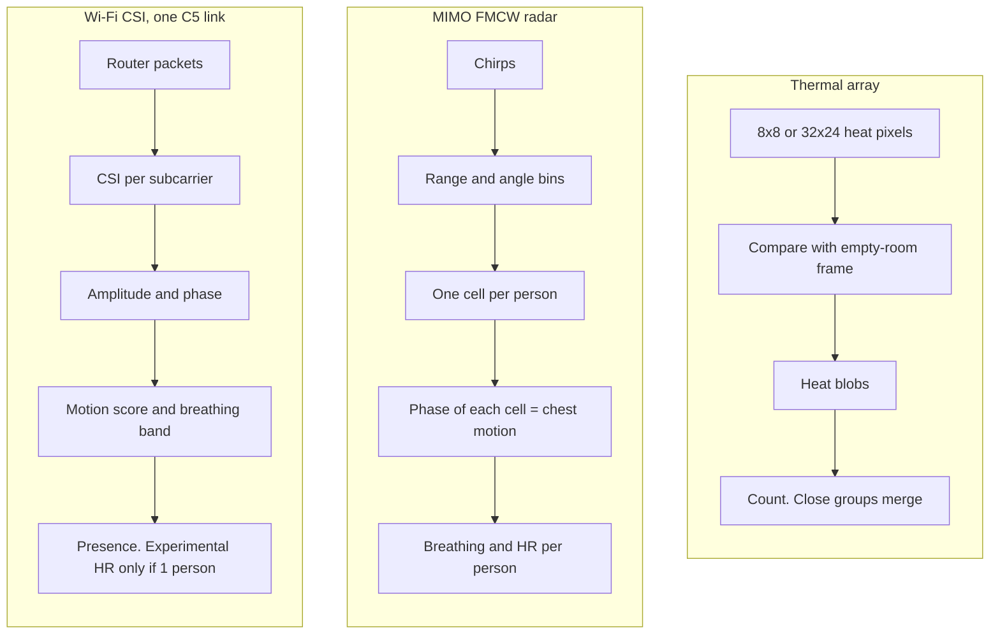


*One 20 MHz Wi-Fi link puts the whole room in one 7.5 m range bin. A MIMO radar splits the room into centimetre range bins and angle cells, so each chest can get its own cell (7.5 m: [ViMo](https://originwirelessai.com/wp-content/uploads/2024/04/ViMo_fengyu.pdf), [Lambrecht 2026, preprint](https://arxiv.org/abs/2608.20322); radar 3.75-5.8 cm: Eder, [Benny](https://arxiv.org/abs/2511.21314)).*

---

## 6. Ready products compared

Columns: **Counts (max)** as stated; **HR (1 / multi)** = one person / several at once; **Evidence** = who makes the claim. "—" = the product does not offer it. Picked rows only; **more in the [full report §2](research/2026-11-16_full_report.md#2-ready-product-comparison).**

### 6.1 Wi-Fi sensing products

| Product | Tech | Counts (max) | HR (1 / multi) | Price USD | Price INR | Evidence | Link |
|---|---|---|---|---|---|---|---|
| Xfinity WiFi Motion | ISP gateway CSI | no (motion) | no / no | Shield Select US$15/mo | not sold in India | vendor | [FAQ](https://www.xfinity.com/support/articles/wifi-motion-faqs) |
| Origin AI (now ADT) | CSI, licensed to ISPs | "counting", no number | engine listed, no numbers / not claimed | B2B | not found | vendor | [white paper](https://www.originwirelessai.com/wp-content/uploads/2025/05/Origin-AI_Wifi-Sensing-White-Paper-2025-05-16-PROOF.pdf) |
| Caregiver by Cognitive | gateway + 4 plugs | no | no / no | waitlist | not found | vendor | [page](https://www.cognitivesystems.com/caregiver/) |
| Plume WorkPass Flow | motion on SuperPods | no | no / no | ISP quote | not found | mixed | [datasheet](https://cdn.plume.com/a3/d5/5fc58de24a6cb38dc335becbd5a8/datasheet-workpass-en-032526.pdf) |
| WiZ SpaceSense | motion between lights | no | no / no | not found | ₹1,740 per light | vendor | [FAQ](https://faq.wizconnected.com/hc/en/7-wiz-v2/section/144-automation-spacesense) |
| Philips Hue MotionAware | **Zigbee RSSI**, not Wi-Fi | no | no / no | Bridge Pro US$139.99 (search summary) | ≈₹13,215 converted | vendor | [support](https://www.philips-hue.com/en-ca/support/article/motionawaretm--transform-your-hue-lights-into-motion-sensors/000011) |
| Huawei FTTR "Wi-Fi radar" (China) | CSI in home gateways | not stated | listed, uses paired mmWave / no | not found | not found | vendor | [c114](https://m.c114.com.cn/w126-1318853.html) |
| ESPectre 3.2.0 | ESP32 CSI motion (incl. C5) | no | no / no | free (GPLv3) | board only | maker | [README](https://raw.githubusercontent.com/francescopace/espectre/main/README.md) |
| RuView | ESP32-S3/C6 CSI | 62.3 % on 0 vs 1 only | "unvalidated" / no | node ~US$9 | ≈₹845 (@93.93) | maker | [repo](https://github.com/ruvnet/RuView) |
| VergeSense Wi-Fi analytics | **counts devices**, not CSI | "85 %" by floor | no / no | not found | not found | vendor | [PDF](https://www.vergesense.com/hubfs/VergeSense%20WiFi%20Analytics%20Overview.pdf) |
| **This project (ESP32-C5)** | CSI, one 20 MHz link | 0/1/2+ experimental, **not measured** | experimental, 1 person, not validated / never | ≈US$15 (2025) | ₹695-1,522 | maker (own) | [DigiKey.in](https://www.digikey.in/en/products/result?keywords=ESP32-C5-DEVKITC-1) |

### 6.2 Radar modules for makers

| Product | Tech | Counts (max) | HR (1 / multi) | Price USD | Price INR | Evidence | Link |
|---|---|---|---|---|---|---|---|
| Hi-Link LD2410 / C | 24 GHz 1T1R | 1 | no / no | "under $10" (LD2410C, XDA) | ₹379 (unconfirmed) | vendor + independent | [manual](https://www.elemon.com.ar/images/industry_news/11-HLK-LD2410-user-manual-V1.02.pdf) |
| Hi-Link LD2450 | 24 GHz 1T2R | **3** moving | no / no | US$4.46 (COMPARISON.md, not re-checked) | ₹999 incl. GST | vendor + integrator | [Probots](https://probots.co.in/hlk-ld2450-24ghz-mmwave-tracking-radar-sensor.html) |
| Hi-Link LD2460 | 24 GHz 2T4R | ≥3 still, 5 moving | no / no | not found | not found | vendor | [manual](https://revspace.nl/images/9/9d/HLK-LD2460_2T4R_Multi_Target_Trajectory_Tracking_Module_Manual_V1.1.pdf) |
| Hi-Link LD6002 | 60 GHz | **1** | "90 %" undefined / no | US$16.95 | ₹1,988-2,540 (unconfirmed) | reseller | [electropeak](https://electropeak.com/hi-link-ld6002-60g-heart-rate-and-breathing-monitoring-module) |
| Seeed MR60BHA2 kit | 60 GHz, 58-62 GHz | up to 3, "reference only"; one user saw only 0 or 1 (**conflict**) | "only supports one person"; r ≈ 0.33 vs H10 (one user) / no | US$24.21 | ₹3,332.65 | vendor + maker | [datasheet](https://files.seeedstudio.com/wiki/mmwave-for-xiao/mr60/datasheet/MR60BHA2_Breathing_and_Heartbeat_Module.pdf) |
| DFRobot C1001 | 60 GHz, 61-61.5 GHz | no (FAQ read two ways: **conflict**) | read 8-17 bpm low (vendor test) / no | US$29.00 | ₹2,758.19 | vendor + maker | [vendor test](https://www.dfrobot.com/blog-13919.html) |
| MinewSemi ME72MS02 | 60 GHz 2T2R | **1** | 90 % within ±5 bpm, supine / no | not found | not found | vendor | [page](https://en.minewsemi.com/millimeter-wave-radar/me72ms02) |
| TI IWR6843 people counting | 60 GHz 3TX/4RX EVM | "up to 20"; tested to 6 | one track (unconfirmed) / no | behind login | not found | vendor | [TIDUE71D](https://www.ti.com/lit/ug/tidue71d/tidue71d.pdf) |
| Everything Presence Lite / Pro | LD2450 + PIR | 3 | no / no | Lite US$39 (Oct 2026) | not found | vendor | [shop](https://shop.everythingsmart.io/products/everything-presence-pro) |

### 6.3 Radar products

| Product | Tech | Counts (max) | HR (1 / multi) | Price USD | Price INR | Evidence | Link |
|---|---|---|---|---|---|---|---|
| Aqara FP2 | 60 GHz FMCW | 5, best ≤3 | Sleep mode, press-only / no | US$82.99 | ₹11,777 | vendor | [spec sheet](https://phuongviethcm.com/wp-content/uploads/2025/10/20250925-Specification-Aqara-Cb-FP2.pdf) |
| Aqara FP400 | 60 GHz 4T4R | "up to 10" | no / no | US$79.99 | ≈₹7,551 converted | vendor | [US page](https://us.aqara.com/products/spatial-multi-sensor-fp400) |
| Density Waffle | radar | **0/1/2/3+ classes** | no / no | US$279 + software (conflict: "<$150" tier) | ≈₹26,338 converted | vendor | [Waffle](https://www.density.io/waffle) |
| Framery Room Sensor | PIR + mmWave | up to 7 | no / no | EUR 149 + 5.90/mo | ≈₹15,515 + ₹614/mo (lane conversion, implied ≈104.1 INR/EUR) | vendor | [Framery](https://framery.com/en/smart-office-solutions/framery-room-sensor/) |
| Milesight VS373 | 60 GHz 4D | not specified | no / no | US$330 (unconfirmed) | not found | vendor | [datasheet](https://resource.milesight.com/milesight/iot/document/vs373-datasheet-en.pdf) |
| Vayyar Care | 4D imaging radar | not stated | no / no | not listed | not found | vendor | [docs](https://vayyar.com/care-docs/b2c/) |
| Sakura Tech miRadar8 VSM | 24 GHz MIMO | "multiple targets" | — / **claimed, no count or accuracy; "under development"** | on request | not found | vendor | [catalogue](https://pr.mono.ipros.com/sakuratech/product/detail/2000530489/) |
| MotionCatch SE (Japan) | mmWave + AI | 8 at once | "reference value", not per person | quote | not found | vendor | [IPROS](https://pr.mono.ipros.com/intercompo/product/detail/2001540441/) |
| Harman / CAARESYS | in-cabin radar | not stated | "each occupant", **no count or accuracy** | not found | not found | vendor | [iConnect007](https://iconnect007.com/article/133267/harman-acquires-incabin-radar-sensing-pioneer-caaresys/133270/aep) |

### 6.4 Medical and sleep vitals

| Product | Tech | Counts (max) | HR (1 / multi) | Price USD | Price INR | Evidence | Link |
|---|---|---|---|---|---|---|---|
| Xandar Kardian XK300 | IR-UWB radar | "a patient" | 60-120 bpm, bench tests only / no | not found | not found | regulator + vendor | [510(k)](https://www.accessdata.fda.gov/cdrh_docs/pdf20/K202464.pdf) |
| Neteera 130H-Plus | 122 GHz radar | bed-centred | 40-160 bpm, numbers unpublished / no | not found | not found | regulator + vendor | [510(k)](https://www.accessdata.fda.gov/cdrh_docs/pdf23/K231733.pdf) |
| Sleepiz One+ | CW Doppler radar | one adult | **94 % within ±5 bpm** vs ECG / no | not found | not found | regulator | [510(k)](https://www.accessdata.fda.gov/cdrh_docs/pdf22/K223163.pdf) |
| Withings Sleep Analyzer | under-mattress BCG | 1 per mat | MAE <2.12 bpm (independent) / no | not found | ₹19,200-19,700 (unconfirmed) | mixed | [Ravindran 2024](https://www.medrxiv.org/content/10.1101/2023.10.13.23296936) |
| Emfit QS | under-mattress BCG | 1 per sensor | yes; data loss in 47 % / "impossible" for two | US$338 (unconfirmed) | not found | mixed | [FAQ](https://emfit.com/faq/) |
| Dozee VS (Bengaluru) | under-mattress BCG | 1 per bed | MAE <3 bpm (vendor-authored) / no | not found | not found | vendor | [site](https://dozeehealth.ai/) |
| Camera rPPG (FaceHeart, NuraLogix, Presage) | camera | **one face** | 1.3-2.5 bpm RMSE class / no | Presage free for institutions | not found | regulator (sponsor data) | [K254169](https://www.accessdata.fda.gov/cdrh_docs/pdf25/K254169.pdf) |
| Polar H10 (reference) | chest-strap ECG, BLE | 1 per wearer | reference / one each | US$89.95-104.95 (unconfirmed) | **₹8,999** | mixed | [Polar India](https://store-in.polar.com/products/polar-h10-1) |
| Oura Ring 4 / WHOOP 4.0 | finger / wrist PPG | 1 per wearer | night resting HR MAPE 1.94 % / 3.00 % / one each | not found | ₹28,900 + ₹599/mo (2026-03) / ₹19,999 | mixed | [Digit](https://www.digit.in/news/wearable-devices/oura-ring-4-debuts-in-india-with-50-health-metrics-starts-at-rs-28900.html) |

### 6.5 People counters

| Product | Tech | Counts (max) | HR (1 / multi) | Price USD | Price INR | Evidence | Link |
|---|---|---|---|---|---|---|---|
| Milesight VS133 / VS135 | ToF + AI | line, "up to 99.8 %" | — | US$598-747.50 (unconfirmed) | ₹56,241 | vendor | [VS133 datasheet](https://cdn.shopify.com/s/files/1/0067/0249/7890/files/vs133-datasheet-en.pdf) |
| Milesight VS121 | AI fisheye camera | region "up to 95 %" | — | not found | not found | vendor | [datasheet](https://cdn.shopify.com/s/files/1/0447/5633/6807/files/vs121-vs121-p-datasheet-en.pdf) |
| Terabee L-XL | IR ToF | door, 98 % | — | EUR 1,016 (unconfirmed) | ₹97,402.15 | vendor | [DigiKey.in](https://www.digikey.in/en/products/detail/terabee-sas/TB-PCL-XL-LORA-EU-W/17047393) |
| Xovis PC series | 3D stereo | not in datasheet | — | not found | ₹1,00,000 excl. taxes | vendor | [datasheet](https://api.xovis.com/fileadmin/user_upload/file/ressources/PC3-O_Technical_Datasheet.pdf) |
| V-Count Nano AI | stereo + AI | line, "up to 99 %" | — | US$299-599 + US$9-49/mo | ≈₹38,421-1,12,052 first year, converted | vendor | [pricing](https://v-count.com/pricing/) |
| Density Open Area / Entry | radar / depth | by tolerance; in/out | — | US$299 + US$0.99/sqft/yr + install (2024 quote) | ≈₹28,225 per sensor, converted | vendor | [quote page](https://density.io/pricing/cab2024) |
| Butlr Heatic 2 | low-res thermal | "95 %" vs 85-92 % (**conflict**) | — | US$280/yr (undated page) | via Propstack | vendor | [Heatic 2](https://www.butlr.com/platform/heatic-2-sensor) |
| XY Sense Area Pro | on-device vision | "up to 255", "~99 %" | — | not found | not found | vendor | [XY Sense](https://www.xysense.com/area-pro) |
| FootfallCam 3D ProWave | mmWave radar | "up to 99.5 %" | — | quote | ₹45,000 excl. taxes (IndiaMART, model not named) | vendor | [ProWave](https://www.footfallcam.com/Product/FootfallCam-3D-ProWave) |
| Frogsplash (India) | camera / stereo | "up to 98 %" | — | — | ₹15,000-45,000 | vendor | [IndiaMART](https://m.indiamart.com/frogsplashtechnology/) |

### 6.6 Other technologies

| Product | Tech | Counts (max) | HR (1 / multi) | Price USD | Price INR | Evidence | Link |
|---|---|---|---|---|---|---|---|
| Amazon Echo ultrasound | ≥32 kHz Doppler | no (motion) | no / no | not found | Echo Dot ₹4,999-5,499 (2023) | vendor | [Amazon Science](https://amazon.science/blog/the-science-behind-ultrasonic-motion-sensing-for-echo) |
| Panasonic Grid-EYE AMG8833 | 8 × 8 thermopile | door, 100 % in a lab month | no / no | US$44.95 breakout | ₹2,140.61 bare | mixed | [Sensors 2021](https://doi.org/10.3390/s21124062) |
| Melexis MLX90640 | 32 × 24 thermopile | no study found | no / no | US$39.95-74.95 | ≈₹3,771-7,075 converted | vendor | [Adafruit](https://www.adafruit.com/product/4407) |
| SensFloor | capacitive floor | "number of people", no figure | no / no | quote | not found | vendor | [Future-Shape](https://future-shape.com/en/system/) |
| Cisco Meraki Location Analytics | Wi-Fi probe RSSI | devices only | no / no | — | — | vendor | [Meraki docs](https://documentation.meraki.com/MR/Monitoring_and_Reporting/Location_Analytics) |
| ESPARGOS One | phase-synced ESP32 array | not evaluated | no / no | EUR 350 core kit (EU B2B) | not found | vendor | [shop](https://buy.espargos.net/) |

---

## 7. Pros and cons per technology

| Tech | 👍 Pros | 👎 Cons |
|---|---|---|
| Wi-Fi CSI, single link | Low cost (₹695-1,522); reuses the router; no images | No range or angle separation; per-room calibration; AGC and beamforming affect capture; no C5 accuracy yet |
| Wi-Fi CSI mesh | More links: better counting and localisation | Every link's placement matters; more links can dilute the signal; no multi-person HR |
| ISP / router motion | No extra hardware; mass reach | Motion only; pets trigger it; cloud data disclosure; not in India |
| 24 GHz radar | Still presence (LD2410, ₹379 unconfirmed); X/Y for 3 moving people (LD2450, ₹999) | Sees through thin walls; 1-3 targets; gate tuning took a maker days |
| 60 GHz radar | Still presence; zones; one-person vitals modules | Vitals one person within 1.5 m; weak HR where tested; India band (only 61-61.5 GHz) |
| 77-79 GHz MIMO (research) | The main radar route to multi-person HR (research); 3D tracks | EVM plus PC; error grows with distance (Benny, single subject: 2.11 bpm at 1 m, 10.39 at 6 m); needs angular spacing |
| UWB / medical radar | FDA-cleared single-patient vitals; through bedding | No multi-person HR claim; no public price |
| Thermal array | Battery, anonymous, works in the dark | Merges close groups; heat sources and sunlight; empty-room boot reference |
| ToF / stereo counter | Best door accuracy claims; proven in retail | Door only; ceiling work; IR sources, glass, dark carpet; subscription |
| AI camera | Counts seated people; large coverage | Camera privacy; needs light |
| Camera rPPG | Cleared HR at 1.3-2.5 bpm RMSE | One face; still; lit; camera in the room |
| PIR | Cheapest; standard test method | Misses still people; cannot count |
| CO2 | Already in HVAC | ±4 people; slow |
| BLE / device counting | Identity (staff) | Counts devices, not people |
| Under-mattress BCG | Good HR when it outputs (MAE <2.12 bpm, independent) | One per sleeper; data loss (Emfit 47 %); some bed types excluded |
| Wearables | Ground truth (Polar H10) | Must be worn; one per person |
| Acoustic sonar | Multi-person HR in research with cheap speaker + mic arrays | Lab rigs only; fans and washers raise error; microphones |

Sources per row: full report §3.2.

---

## 8. Correct installation

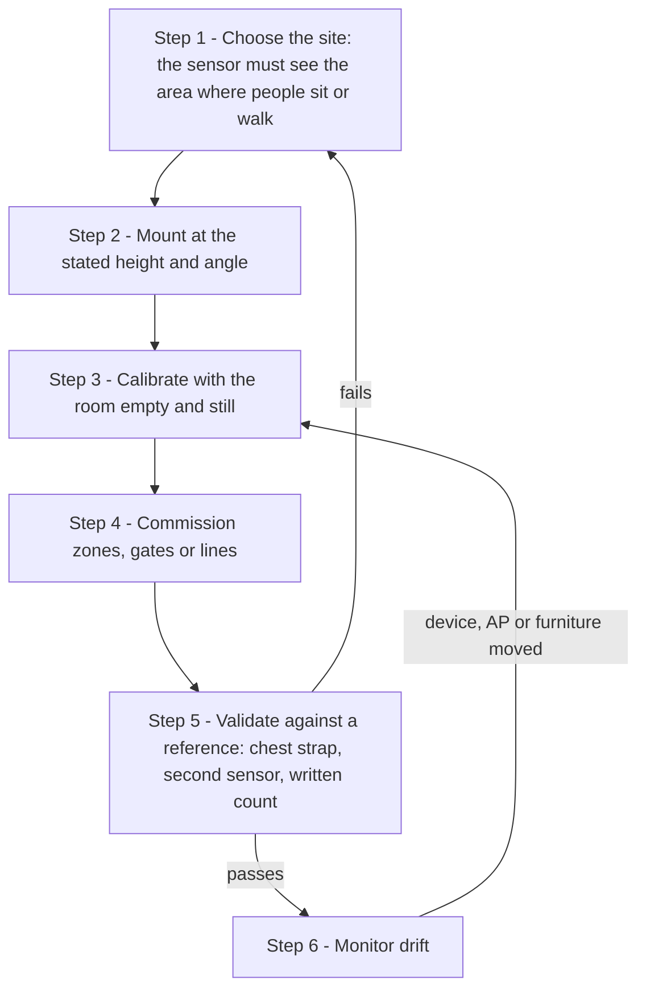

**Per-technology summary** (from vendor guides and papers; "not found" = no source gives a number)

| Tech | Mount height / position | Distance | Calibration | What breaks it |
|---|---|---|---|---|
| Wi-Fi CSI | ≥2 nodes per area; link crosses the walking route; body height (research tripods 1 m) | AP 3-8 m, RSSI −40 to −70 dBm; TX 1-1.5 m from a wall | Empty, still room (ESPectre 10-30 s; WiZ 10 min) | Fans, curtains, pets, robot vacuums; roaming; blocked ping |
| 24 GHz radar | Wall 1.5-2 m; LD2460 side 2.2-2.7 m, tilted 25-40° | ~5-6 m | Tune one distance gate at a time; timeout longer than 5 s for seated people | Curtains, fans, plants, metal; thin walls; radars facing each other |
| 60 GHz vitals radar | Side at chest height, or 1 m above the bed head tilted 45° | Chest 0.4-1.5 m | ~1 min to lock; one person at rest | Noisy USB power; large movement; fans; C1001 invents vitals for 60 s after the person leaves |
| Counting radar | Wall 1.5-2.5 m, 10-15° down (TI); ceiling 2.3-4 m (VS373, FP400) | 6-14 m (TI) | Boundary boxes; mark edges and interference with the room empty (FP2) | Ghost targets from fans, curtains, mirrors |
| ToF / stereo door counter | Ceiling, straight down; Density Entry 2.3-3.0 m; Terabee 2.4-4.0 m | ≥50 cm from walls; ≥30-40 cm from the door swing | Xovis: height within ±5 cm, re-calibrate after a 1° tilt; check against a manual count | 940 nm IR sources, glass, mirrors, sunlight, dark carpet |
| Thermal (ceiling) | Straight down, 2.0-3.5 m (Attune) | ~3.1 m (Butlr) | Scene clear for 90 s after power-up | Hot or cold surfaces, reflections |
| AI camera | VS121 above 2.5 m (seated) or 3 m (standing) | not found | Draw regions; privacy assessment (DPIA) | Low light |
| Camera rPPG | Static mount, technician-installed (Presage) | 0.2-1.5 m | Light >100-300 lux | Movement; a second face |
| Under-mattress BCG | Under the mattress at heart level | — | Withings: wait 10 min with the bed empty | Waterbeds, air beds, articulated beds; two people on one sensor |
| Polar H10 | Chest strap, snug | worn | Moisten the electrodes | Dry or loose strap |

### 8.1 Checklist for this ESP32-C5 project


*When the AP beamforms to the C5, the shipped setting (`acquire_csi_beamformed = 0`) received almost no CSI. One AP, one session (2026-11-05).*

**Board finding, 2026-11-05 (one 11ax AP, one session).** Recorded only in the log folder `~/ESP32C5_CSI_logs/2026-11-05_hw/` (outside the repo); **not yet in TESTING §5 or DECISIONS**. The AP advertised `bfmer(su:1, mu:1)` (log `csidiag_150s.log`). A diagnostic build cycled six CSI configs; cfg 4 is the Step 08/10 default, cfg 2 is `CSI_LLTF_ONLY`.

| Run | Board beamformee | Configs with `beamformed = 0` | Configs with `beamformed = 1` | cfg 2 (`CSI_LLTF_ONLY`) | Log |
|---|---|---|---|---|---|
| Default | enabled | **0-2** CSI per 10 s (cfg 4, the Step 08/10 default: 0 in both windows; the 2s were 11g frames from other senders) | 453-476 per 10 s (HE-SU) | 0-2 per 10 s | `csidiag_150s.log` |
| Beamformee disabled | disabled | 453-483 per 10 s | 443-465 per 10 s | **0** per 10 s | `csidiag2_bfee_off_140s.log` |

- Either disabling beamformee on the board or accepting beamformed CSI restores about 44-48 CSI/s.
- The diag counted only about 187-227 CSI per window from the AP's MAC, so do not read the totals as "all from the AP".
- Beamformed CSI is precoded, so it may mean something different. Disabling beamformee looks cleaner, **but that is an inference**.
- This is a decision for the user (DECISIONS D-40, D-42), not a change. It should be re-tested on the laptop hotspot and a second 11ax router.

**Commissioning checklist** (report §4.2)

1. **Port and board:** confirm the port first. Avoid GPIO16-22 for any sensor UART (a project note, not re-checked against a datasheet).
2. **AP:** one AP on a fixed channel, no roaming; pin the BSSID on a mesh. The AP must answer ping or carry HT/HE traffic. With an 11ax AP, decide on beamformee (above) **before** measuring. Check the rate with Step 03/04: expect about 50 CSI/s (hotspot) or 44-48/s (the 11-05 AP).
3. **Placement:** the AP-to-C5 link crosses where people sit or walk, at body height (~1 m). AP 1-1.5 m from walls if possible, 3-8 m from the C5, RSSI −40 to −70 dBm. No metal enclosure; external antenna vertical. For breathing, keep the chest mid-Fresnel-zone, facing the link.
4. **Interference:** no fans, AC airflow on curtains, pets or robot vacuums in the link while calibrating; BLE scanning off.
5. **Calibration:** empty, still room for Step 08's baseline (about 35 s). Re-calibrate after moving the board, the AP or furniture. Log `agc`, `fft`, `gain_chg`.
6. **References at the same time:** one Polar H10 per seated person; an LD2450 or Grid-EYE for counts; a written occupancy log. Without these, no accuracy can be claimed.
7. **Scoring:** 0/1/2+ classes, Density-style "within tolerance", target ≥90 %; report empty-room false PRESENT separately.
8. **Before any deployment:** WPC ETA for the model; DPDP notice and log retention for anything that can identify a person.

---

## 9. Theory in one picture

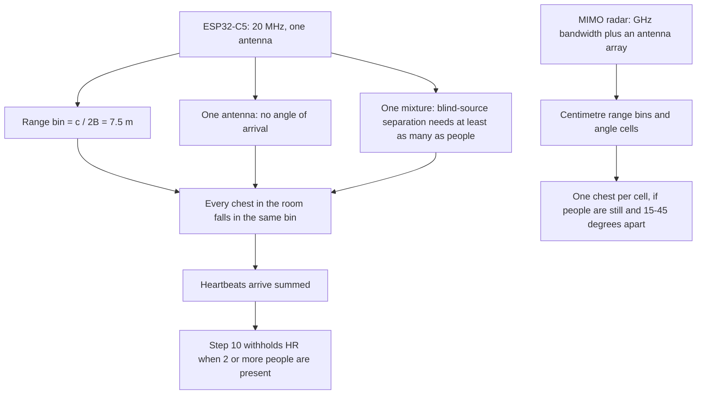


*Several heartbeats on one Wi-Fi link arrive as one summed signal. Systems that measure several people first give each person a separate range or angle cell.*

**The physics in plain words**

- **Range comes from bandwidth:** resolution = c / (2B). At 20 MHz that is **7.5 m**, larger than the room ([ViMo](https://originwirelessai.com/wp-content/uploads/2024/04/ViMo_fengyu.pdf), [Lambrecht 2026, preprint](https://arxiv.org/abs/2608.20322)). TI FMCW radar with 3-4 GHz of sweep gets 3.75-5.8 cm.
- **Angle needs antennas.** One receive antenna gives no direction. Multi-person systems need people apart by ≥15° (Benny) to ≥45° (ViMo).
- **Separating mixed signals needs enough views.** MultiSense uses 3 antennas. The C5's 26 L-LTF tones are not independent views of each chest (an inference from the theory, not a measurement).
- **Fresnel zones:** sensitivity depends on where the person stands. Breathing detection was 98.8 % at good positions and 61.5 % at bad ones (Zhang 2018, via Gu 2019).
- **Heart signals are tiny beside breathing.** Estimators can lock onto a breathing harmonic. Abstaining helps: HEAR (preprint) cut mmWave HR error from 17.9 to 1.6 bpm by skipping the 50 % least observable windows ([arXiv 2610.03570](https://arxiv.org/abs/2610.03570)).
- **AGC (automatic gain control)** steps scale the whole CSI. The project logs `agc` and `gain_chg`; how to handle it is still open.

**Key papers**

| Work | Year | Type | People at once | Metric (authors) | Hardware | Link |
|---|---|---|---|---|---|---|
| Sumi & Sakamoto | 2025 | preprint | **16** (2 radars) | HR MAE 3.69 bpm | two 79 GHz FMCW | [arXiv](https://arxiv.org/abs/2510.10542) |
| Tan et al. | 2025 | preprint | 4 | HR MAE 2.3 bpm | 77 GHz FMCW | [arXiv](https://arxiv.org/abs/2510.19639) |
| Eder et al. | 2025 | preprint | 3 seated | 87 % of HR within 2 bpm | TI IWR1443 | [arXiv](https://arxiv.org/abs/2501.06755) |
| Benny et al. (IEEE Sensors J) | 2025 | peer-reviewed (lanes conflict: preprint per two lanes; full report §10) | 5 separated | no 5-person HR MAE | TI IWR1642 | [arXiv](https://arxiv.org/abs/2511.21314) |
| den Hoedt, TU Delft MSc | 2022 | thesis | 4 | HR 9.91-18.94 % error | 60 GHz IWR6843 | [repository](https://repository.tudelft.nl/record/uuid:63813064-dee6-41bc-b4f6-32ea42cb9ff3) |
| SpaceBeat (IMWUT) | 2024 | peer-reviewed | 3 on Wi-Fi | HR 95.2 % (1 − rel. error) | Intel 5300, 2 × 9 antennas | [PAR](https://par.nsf.gov/servlets/purl/10554426) |
| ViMo (IoT-J) | 2020 | peer-reviewed | 3 | HR median 1 bpm for two | 60 GHz 802.11ad, 32 antennas | [PDF](https://originwirelessai.com/wp-content/uploads/2024/04/ViMo_fengyu.pdf) |
| Tran, Ma, Balan (Sensors) | 2024 | peer-reviewed | up to 4 | median 0.66 bpm (2 people) | acoustic, 7 mics | [PMC](https://www.ncbi.nlm.nih.gov/pmc/articles/PMC10819445/) |
| Pulse-Fi | 2025 | mixed | 1 | MAE 0.46-0.50 (ESP32 set, shuffled windows) | ESP32 + dedicated TX | [UCSC](https://news.ucsc.edu/2025/09/pulse-fi-wifi-heart-rate/) |
| Wi-CaL (NAIST thesis) | 2022 | thesis | ~5 and ~10 | median count error 0.35-0.41 | 4 ESP32 links | [thesis](https://naist.repo.nii.ac.jp/record/11764/files/R017974.pdf) |
| Guo et al., bus counting | 2024 | preprint | 0-20 | 94.86 % (2 RX); 77-90 % (1 RX) | 2 Raspberry Pi | [arXiv](https://arxiv.org/abs/2410.11400) |
| Wall-Proximity Matters | — | peer-reviewed | 5 stationary | +2.1-11.2 % counting, TX 1-1.5 m from wall | Nexmon 80 MHz | [arXiv](https://arxiv.org/html/2412.13208v4) |

---

## 10. Videos worldwide

**No video was watched and no transcript was fetched.** Each row rests on the description, chapters and linked repository. Credibility: high = measured against a reference; medium = maker numbers without a reference; low = claims without data, or a sponsored or provided unit.

| Title | Channel | Date | Lang | Shows | Credibility | Link |
|---|---|---|---|---|---|---|
| Can You Hide From WiFi? Build a Radar to Find Out | Talking Sasquach | 2026-11-15 | EN | First popular **ESP32-C5** CSI build; ~49 CSI/s on 5 GHz; HR "not verified"; "no head count" | medium | [video](https://www.youtube.com/watch?v=o4IVyARjKyY) |
| DevCon26: no_std Rust CSI stack | Espressif DevCon26 | 2026-11-15 | EN | Rust CSI collector with a C5 target | medium | [video](https://www.youtube.com/watch?v=g5CDmULguh8) |
| Contactless Heartbeat & Respiration Using WiFi | srk_nd / pvkkr (India) | 2026-11-02 | EN | "~98.5 %" HR claim; README trials all read high | low | [video](https://www.youtube.com/watch?v=W2XJ5NhWQsE) |
| ESP32-S3 WiFi CSI Sensing: Real-Board Test | winson-DIY | 2026-11-04 | ZH (EN subs) | High-mounted AP gave only ~40 % contrast | medium | [video](https://www.youtube.com/watch?v=SC--Egz0Z8g) |
| RuView: WiFi Sensing in Practice | CLI Stack | 2026-10-28 | EN | RuView's "proof" validates only a synthetic fixture | high (independent) | [video](https://www.youtube.com/watch?v=OW1megnp2ZE) |
| Ragnar RuSense: Camera Free Surveillance | Valleytech | 2026-07-08 | EN | Through-wall count and HR claims, no data | low | [video](https://www.youtube.com/watch?v=q2XMGHuvNaE) |
| MobiSys 2021: Counting a Stationary Crowd | ACM SIGMOBILE | 2021-06-23 | EN | Up to 10 seated people from Wi-Fi received power | high (peer-reviewed) | [video](https://www.youtube.com/watch?v=A0bQTQJJqeQ) |
| ESP-CSI: Transforming Wi-Fi into a Sensing Platform | Espressif | 2025-08-21 | EN | Vendor overview, no accuracy | medium (vendor) | [video](https://www.youtube.com/watch?v=JjdpzM6zVJ8) |
| Xfinity WiFi Motion coverage | LMGClips | 2026-09-02 | EN | Motion only; data disclosure | high (on privacy) | [video](https://www.youtube.com/watch?v=UAMkobKSQtY) |
| I Built a LAMP That Tracks Your Sleep (C1001) | techiesms (India) | 2026-07-27 | EN | One-person HR/BR at 0.5-0.8 m; clean 5 V needed | medium | [video](https://www.youtube.com/watch?v=KlZlvOph3Yc) |
| ME72MS02 single-person respiration & HR | MinewSemi | 2026-09-01 | EN | Max targets 1 | medium (vendor) | [video](https://www.youtube.com/watch?v=d2I3_CWcWz8) |
| Non-contact breathing for two subjects | AlephZero | 2026-03-02 | EN | 2 sleepers separated by range; no reference | low | [video](https://www.youtube.com/watch?v=Ipf5VPLMiT0) |
| [mLAB] Vital signs of four people on one radar | Millilab | 2023-01-18 | not stated | "vital signs" of 4; **HR not named**; no accuracy | low | [video](https://www.youtube.com/watch?v=0wpfyshEUXo) |
| This $10 Radar Tracks You Through a Wall (LD2450) | That Project | 2026-08-23 | EN | 3-target tracking through drywall | medium | [video](https://www.youtube.com/watch?v=hhtvjLvmlTY) |
| Ich habe 9 Präsenzmelder getestet | simon42 | 2026-02-25 | DE | 9-sensor comparison; FP2 "more prone to ghosting" | medium-high | [video](https://www.youtube.com/watch?v=TtcnaOMl8IA) |

**No video, from any technology, shows HR for 2 or more people against a reference.** Bilibili returned captcha pages, so Chinese platforms were not reviewed. More rows: full report §6.

---

## 11. Price per capability (India)

| Capability | Cheapest credible | Mid | Enterprise / medical | Source |
|---|---|---|---|---|
| Presence incl. still people | LD2410 ₹379 (unconfirmed) + host MCU; LD2450 ₹999 detects moving people only | Aqara FP2 ₹11,777 | Milesight VS370 (price not found) | [Probots](https://probots.co.in/hlk-ld2450-24ghz-mmwave-tracking-radar-sensor.html) |
| Motion only (Wi-Fi, retail) | WiZ SpaceSense, 2 lights ≈ ₹3,480 | Hue Bridge Pro ≈₹13,215 converted | ISP gateways (not in India) | [Philips India](https://in.shop.lighting.philips.com/products/philips-smart-wifi-neo-led-downlight) |
| Room count 0-3 / 0-5 | LD2450 ₹999 (3 moving) | FP2 ₹11,777; FP400 ≈₹7,551 converted | Density Waffle ≈₹26,338 + software | [Density Waffle](https://www.density.io/waffle) |
| Door in/out | Grid-EYE ₹2,141 bare + DIY | Marketplace counters ₹15,000-45,000 | VS133 ₹56,241; Terabee ₹97,402; Xovis ₹1,00,000 | [DigiKey.in AMG8833](https://www.digikey.in/en/products/result?keywords=AMG8833), [Terabee DigiKey.in](https://www.digikey.in/en/products/detail/terabee-sas/TB-PCL-XL-LORA-EU-W/17047393) |
| HR, one person, contactless | C1001 ₹2,758-3,516 | MR60BHA2 ₹3,333-6,999 | XK300, Neteera, Sleepiz, Dozee: not found | [DigiKey.in C1001](https://www.digikey.in/en/products/detail/dfrobot/SEN0623/24854509) |
| HR reference, one person | Polar H10 ₹8,999 | Withings ₹19,200-19,700 (unconfirmed) | — | [Polar India](https://store-in.polar.com/products/polar-h10-1) |
| **HR for 2+ people, one sensor** | **no priced product exists** | miRadar8: on request, "under development" | TI EVM + PC (behind login) | [Sakura Tech](https://pr.mono.ipros.com/sakuratech/product/detail/2000530489/) |

The ESP32-C5 node costs ₹695-1,522 but has **no measured presence accuracy**. Every vitals product with a stated person count is one per person or bed, so cost grows with the number of people.

**DIY validation rig** (gives the C5 a second receiver and reference sensors; GST basis varies by seller)

| Item | Role | Qty | Unit (₹) | Subtotal (₹) | Source |
|---|---|---|---|---|---|
| ESP32-C5-DevKitC-1-N8R8 | second CSI receiver | 1 | 1,426.65 | 1,426.65 | [DigiKey.in](https://www.digikey.in/en/products/result?keywords=ESP32-C5-DEVKITC-1) |
| Polar H10 | HR reference, one per seated person | 2 | 8,999 | 17,998.00 | [WOD Armour](https://www.wodarmour.in/products/polar-h10-heart-rate-sensor) |
| HLK-LD2450 | count and X/Y reference (3 moving max); India 24 GHz fit unknown | 1 | 999 | 999.00 | [Probots](https://probots.co.in/hlk-ld2450-24ghz-mmwave-tracking-radar-sensor.html) |
| DFRobot C1001 | one-person breathing / presence reference | 1 | 2,758.19 | 2,758.19 | [DigiKey.in](https://www.digikey.in/en/products/detail/dfrobot/SEN0623/24854509) |
| Grid-EYE AMG8833 (bare) | door in/out reference | 1 | 2,140.61 | 2,140.61 | [DigiKey.in](https://www.digikey.in/en/products/result?keywords=AMG8833) |
| Vernier respiration belt | breathing reference (educational, no accuracy statement) | 1 | not found | — | [Vernier](https://www.vernier.com/product/go-direct-respiration-belt/) |
| **Total (listed items)** | | | | **25,322.45** (≈US$268) | sum of rows |
| Minimum set (C5 + 1 × H10 + LD2450 + C1001) | | | | **14,182.84** | sum of rows |

The MR60BHA2 is left out on purpose: its 58-62 GHz sweep lies outside India's licence-exempt 61-61.5 GHz slice. The LD2450's 24 GHz sweep was not found either, so its India band fit is unknown.

---

## 12. Standards and regulation

| Topic | Rule | What it means here | Link |
|---|---|---|---|
| Wi-Fi sensing standard | IEEE 802.11bf-2025, published 2025-09-26; "does not define use of the measurements" | The C5 has no 11bf; the standard adds no antennas or bandwidth and sets no accuracy bar | [IEEE](https://standards.ieee.org/ieee/802.11bf/11574/) |
| Detection-range test | IEC 63180:2020 + AMD1:2025 (PIR) | Its walk-test grid can be borrowed for commissioning; no pass/fail line | [IEC webstore](https://webstore.iec.ch/en/publication/61559) |
| US 60 GHz radar | FCC 47 CFR 15.255 as amended (FCC 23-35), effective 2023-08-23; names breathing detection | US legal basis for 60 GHz vitals radar | [DA 23-698](https://docs.fcc.gov/public/attachments/DA-23-698A1.pdf) |
| India bands | 2.4 GHz, 5 GHz, 24 GHz SRD and **only 61-61.5 GHz** at 60 GHz are licence-exempt | C5 fine; C1001 fits on paper; MR60BHA2 (58-62 GHz) does not; FP2 band not found; LD2410/LD2450 sweep not found, so their fit to 24.00-24.25 GHz is unknown (24 GHz row from secondary sources; **conflict**, full report §10) | [TRAI rec.](https://www.trai.gov.in/sites/default/files/2025-12/Recommendation_10122025.pdf) |
| India V-band proposal | TRAI recommended licence-exempt 57-66 GHz (2025-12-10) | **Not yet a rule**: no DoT notification found | [TRAI](https://www.trai.gov.in/sites/default/files/2025-12/Recommendation_10122025.pdf) |
| India type approval | WPC ETA by self-declaration, about ₹10,000 per model, 4-6 weeks (secondary source) | Needed for any C5 product sold in India | [PCN guide](https://pcnindiaglobal.com/2026/07/06/wpc-de-licensed-frequency-bands-india-complete-guide/) |
| India product safety | BIS CRS covers IT power adaptors and CCTV cameras | The plug adaptor needs BIS | [BIS list](https://www.crsbis.in/BIS/products-bis.do) |
| India data protection | DPDP Rules 2025: Rule 4 in force about 13/14 Nov 2026; main duties about 13/14 May 2027 | Anonymous counts are low risk; gait ID and per-person HR are personal data (inference) | [gazette PDF](https://www.meity.gov.in/static/uploads/2025/11/53450e6e5dc0bfa85ebd78686cadad39.pdf) |
| India medical software | CDSCO draft guidance (2025-10-21): health-monitoring software is a device | Keep `hr_bpm_exp` labelled experimental and non-medical | [India Briefing](https://india-briefing.com/news/cdsco-draft-guidance-medical-software-40691.html) |
| US wellness | FDA General Wellness policy (revised 2026-01-06): values that "mimic those used clinically" need validation | No clinical-accuracy claims for a wellness HR | [FDA](https://www.fda.gov/media/90652/download) |
| US medical HR bar | FDA 510(k) clearances, all single patient; camera bar RMSE ≤3 bpm | A medical HR claim means about 3-5 bpm, one person at rest | [K223163](https://www.accessdata.fda.gov/cdrh_docs/pdf22/K223163.pdf) |
| Privacy in practice | Comcast may disclose WiFi Motion data; Wi-Fi sensing works through walls | Sensing neighbours is a privacy and false-alarm issue | [9to5mac](https://9to5mac.com/2026/08/18/comcast-just-turned-millions-of-xfinity-routers-into-motion-sensors/) |

---

## 13. Roadmap to a real product

Every step is a **proposal for the user** (report §9), decided through the project's D-number process. None of it is done.

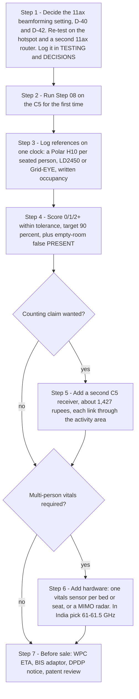

Side test worth one session: SA-WiSense's cross-subcarrier CSI ratio, the only single-antenna fix found for Fresnel blind spots (preprint) ([arXiv 2507.17623](https://arxiv.org/abs/2507.17623)). It was shown at 40 MHz with 218 tones; whether it works on the C5's 26 L-LTF tones is unknown.

---

## 14. Evidence limits and how to read the labels

**Limits**
- The web-search budget ran out in every research lane; "not found" often means "not found in a truncated search".
- Most papers were read as abstracts only. No video was watched.
- Every counting accuracy for a named product (95-99.9 %) is a vendor claim; no independent test was found.
- The 2026-11-05 beamforming result is one session with one AP and has not been through TESTING §5.
- **Nothing here was measured on the ESP32-C5** for presence, counting or vitals. Every accuracy figure is someone else's.
- Open conflicts (Density price, Butlr accuracy, MR60BHA2 counting, C1001 range, and others) are listed in full report §10.

**How to read the evidence labels**

| Label | Means | Trust it as |
|---|---|---|
| vendor | The maker's own page, datasheet or press release | A claim, not a measurement |
| independent | A review or test by a third party | Stronger, still check the method |
| peer-reviewed | A journal or conference paper | Measured, in that paper's lab setup |
| preprint | A paper not yet peer-reviewed | Measured, not checked by reviewers |
| maker | A forum, hobby or open-source author | One person's result |
| regulator | An FDA, FCC or WPC filing | Official record; often sponsor data, sometimes bench tests only |
| unconfirmed | Seen once (often a search snippet), not re-opened | Treat as a hint |
| inference | Reasoned from cited sources, not stated by them | An argument, not a fact |
| converted | INR computed from a USD or EUR price (USD at 94.40 INR/USD; "@93.93" marks the older rate; EUR at the lane's implied ≈104.1 INR/EUR) | Not a seller's price |
